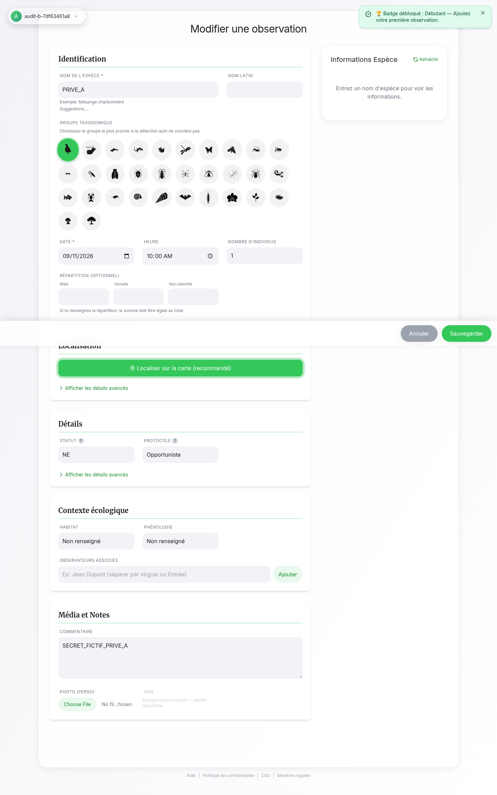

# Carnet naturaliste — Audit de résistance aux attaques

Audit du 11 septembre 2026, commit `0041b1c1964251cb6585ce69eef6f43ceb72bc4f`. Code applicatif et production inchangés pendant l’audit. Tests d’attaque exécutés uniquement sur une copie locale avec comptes et données fictifs.

## Résultat

**Six failles confirmées : trois de gravité moyenne et trois de gravité faible.** Les problèmes principaux concernent la confidentialité des médias et le cloisonnement entre comptes dans le navigateur. Aucun contournement SQL, exécution JavaScript injectée ou suppression du compte d’autrui n’a été démontré dans les scénarios examinés. Ce résultat n’est pas une garantie d’absence de toute vulnérabilité.

| Priorité | Constat | Gravité | Preuve |
|---|---|---|---|
| 1 | Après A → déconnexion → B, un formulaire ouvert conserve les données de A | Moyenne | Navigateur sur bundle réel et vrais comptes Auth locaux |
| 2 | Une réponse tardive de A peut être écrite dans le cache de B | Moyenne | Test déterministe des modules de stockage, retour réseau simulé |
| 3 | Photos et sons consultables sans connexion avec leur lien permanent | Moyenne | Configuration de production et appels locaux sur fichiers fictifs |
| 4 | Le journal commun peut transmettre à B une URL privée enregistrée pendant une erreur de A | Faible | Sauvegarde, déconnexion, journal persistant et interface B testés |
| 5 | Recherches de lieux et presets géographiques partagés entre comptes | Faible | Chemin complet vérifié dans le code ; pas de test navigateur dédié |
| 6 | Import ZIP sans plafond des données décompressées | Faible | Archive de 8 636 octets produisant 8 389 155 caractères, acceptée |

La fuite de formulaire exige l’utilisation successive du même onglet/profil. Le défaut du cache exige en plus un changement de compte pendant une opération. Les URL de médias sont difficiles à deviner, mais restent lisibles par un tiers qui les obtient. L’import piégé nécessite que la victime sélectionne le fichier et affecte son onglet, sans déni de service serveur établi.

## Ce qui a été vérifié

- **Base/API locale :** accès anonyme vide ; lecture, modification et suppression de B depuis A sans effet ; insertion avec propriétaire falsifié et transfert de propriétaire refusés ; lot mixte refusé. Les opérations légitimes fonctionnent.
- **Sessions :** jetons absents, falsifiés et expirés refusés. Le SDK verrouillé nettoie correctement une déconnexion retournant une erreur HTTP 503 simulée.
- **Suppression de compte :** la fonction prend l’identité du jeton. Avec un corps désignant B, seul le compte jeton C et ses médias fictifs sont supprimés ; B reste intact.
- **Injections :** contrôles ciblés sur rendu HTML/PDF, chaînes XLSX, formules CSV, clés de prototype et protocoles d’URL. Aucune exécution malveillante démontrée dans ces parcours.
- **En ligne, lecture seule :** RLS propriétaire active, bucket public avec limite 20 MiB et MIME restreints, fonction déployée identique avec vérification JWT, six en-têtes de sécurité présents sur l’alias officiel.
- **Secrets :** 324 fichiers suivis, 876 blobs historiques et 102 fichiers compilés examinés par motifs connus. Six correspondances étaient des exemples documentaires ; aucun secret confirmé. Les formats inconnus ou encodés peuvent échapper à cette méthode.

Les **459 tests existants**, le contrôle TypeScript, le lint et la compilation passent. Les **32 tests ciblés supplémentaires** passent aussi, dont certains affirment volontairement le comportement vulnérable actuel pour le reproduire. La campagne API compte **36 assertions : 35 conformes et une attente de refus réfutée**, car la route média « authenticated » sert également un objet du bucket public à B. Passer une assertion de reproduction ne signifie donc pas que la protection fonctionne.

## Compléments et limites

- `npm audit` signale **11 paquets : 5 high et 6 moderate**. Ce ne sont pas 11 attaques prouvées sur le site. DOMPurify arrive dans le bundle via jsPDF, mais la méthode vulnérable `pdf.html` n’est pas appelée dans le code inspecté ; les autres alertes concernent principalement l’outillage ou des chemins sans entrée hostile démontrée. Une revue des mises à jour reste nécessaire.
- Supabase signale la protection contre les mots de passe compromis désactivée et un `search_path` non figé sur un trigger. Ces alertes justifient du durcissement ; aucun scénario d’élévation via ce trigger n’a été établi. [Mots de passe](https://supabase.com/docs/guides/auth/password-security#password-strength-and-leaked-password-protection), [alerte search_path](https://supabase.com/docs/guides/database/database-linter?lint=0011_function_search_path_mutable).
- Les réglages complets d’Auth hébergé — confirmation email, minimum réel, MFA, captcha, limites et redirections — restent **non vérifiés**. Les valeurs locales ne prouvent pas les valeurs en ligne.
- Les permissions GitHub Actions par défaut sont en lecture et l’approbation des PR par Actions est désactivée. Les endpoints de protection de branche/rulesets renvoient HTTP 403 avec une restriction de formule ; leur contenu reste non vérifiable par ces appels.
- Le scénario navigateur bloque le service worker pour isoler l’état React. Le cache PWA partagé a été examiné dans le code, sans reproduction HTTPS/PWA dédiée. Sa purge doit accompagner la privatisation des médias.
- Le serveur Supabase neuf exigeait des GRANT explicites absents des migrations. Ils ont été appliqués **uniquement dans le laboratoire**, pour reproduire les permissions observées en production et rendre possibles les contrôles positifs. Le `project_id` local a été renommé ; aucun code applicatif n’a été corrigé.
- Les recherches de dépendances et les métadonnées de production complètent une revue intégrale de **132 fichiers**. Les tests historiques, rapports précédents et illustrations ne sont pas tous relus ligne par ligne. Les surfaces non testées sont documentées dans la matrice.

## Lots de corrections proposés

1. **Séparer les comptes dans le navigateur.** Réinitialiser la partie authentifiée à chaque identité ; lier les opérations asynchrones à un propriétaire et une génération de session immuables ; arrêter les travaux devenus obsolètes ; scinder et expurger journaux, presets et historiques. Vérifier A → B avec formulaire ouvert, requête lente, hors-ligne et rechargement.
2. **Rendre les médias privés.** Bucket privé, chemins d’objet plutôt que liens publics persistants, téléchargement authentifié ou URL signée courte, gestion explicite des caches. Vérifier accès propriétaire, B, anonyme, déconnexion et expiration des liens. Préparer une migration compatible avec les observations et sauvegardes existantes.
3. **Borner les imports.** Budgets sur taille initiale, octets effectivement décompressés, nombre d’entrées/lignes et taille des médias ; parser dans un Worker annulable. Les fichiers légitimes sous les limites doivent continuer de fonctionner.
4. **Durcissement séparé.** Examiner les mises à jour npm, les actions CI épinglées et les alertes Supabase, sans confondre alerte automatique et exploit confirmé.

Chaque lot devra ensuite avoir une branche dédiée, les tests de reproduction inversés en tests de non-régression, `npm run check`, puis une pull request. **Aucun correctif applicatif n’a été effectué pendant cet audit. Le présent dossier en publie les résultats.**

Pour l’audit fonctionnel ultérieur : retenir l’anomalie Excel des synonymes `__proto__`/`constructor` acceptés sans erreur bloquante, la gestion de champs serveur nuls dans le formulaire, et les sujets de synchronisation/restauration. Leur impact fonctionnel reste à examiner séparément.

## Documents et suites

- [Mise en production des corrections — 30 septembre 2026](MISE-EN-PRODUCTION-2026-09-30.md) : état des protections après les PR #83 à #86 ; distinct du constat historique ci-dessus.
- [Rapport détaillé](rapport-audit.md) : preuves source et raisonnement.
- [Matrice des scénarios](MATRICE.md) : protections, failles et limites.
- [Vérifications complémentaires Auth et PWA](VERIFICATIONS-COMPLEMENTAIRES.md).
- [Reproductions locales](reproductions/README.md).
- [Preuves expurgées](preuves/) : résultats et capture sur données fictives.

Les conteneurs, volumes fictifs et réseau du laboratoire ont été supprimés après l’audit. Le commit examiné reste celui indiqué en tête ; ce dossier documentaire n’applique aucune correction.
